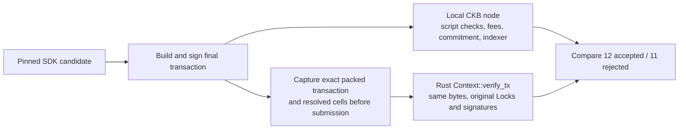

# SDK interoperability acceptance — 2026-11-03

The contract PRs #75 and #76 keep their original review scopes. This branch adds
only a replay test, a recorded transaction fixture and this report. No contract
consensus source, cell schema, package version or deployed public preset changes
are needed for the tested SDK flows.

The SDK adaptation is reviewed separately in
[spore-sdk#142](https://github.com/sporeprotocol/spore-sdk/pull/142), submitted as
[`2b227ff`](https://github.com/a19q3/spore-sdk/commit/2b227ff2396e530074e7387e513fb36da17bcc96).
The current evidence reruns the refined SDK source, including compatibility and
Witness-layout fixes, against the same contract binaries. These results are local interoperability
evidence, not upstream acceptance or release readiness. No SDK package has been
published by this work.

## Exact revisions and environment

| Component | Revision / version |
| --- | --- |
| Contract source / deployed v3 binary source | `46eaa8b59abe818f27dcfe3c7af0da46698c12f8` |
| SDK base | `5e5d886e49bfbd78253e9c14fd8baebccb488a81` (`beta`) |
| SDK candidate tree | `274dc4a707b5f52ed945c3575b4e3bf28d9a76d5` |
| SDK candidate patch SHA-256 | `8f4b1d02da9b8cf5269d1375b59892fafad90f8eee44672b0aa63b4b6de54d1d` |
| Historical contract source for local deployments | `9a6010e43ffd09ac9e6fe7ee389cc915e3e4f999` |
| Node | CKB `0.200.0` (`52c2be1`, official release), built-in indexer, Dummy mining |
| SDK tooling | Node `18.20.8` / `22.23.1`, Lumos `0.24.0-next.1`, Vitest `1.4.0`, TypeScript `5.3.2` |
| Contract build | Rust `1.92.0`, Clang `22.1.8`, ordered release build |

The temporary node listened on loopback only. A new local genesis funded public
fixture keys `[0x2a; 32]` and `[0x2b; 32]`; no production wallet was used. All v2
and v3 deployment outpoints were created on that local chain. The historical
comparison uses a local build of historical source, not a claim that its binary
hashes equal every previously deployed release. No public-network transaction,
SDK package publication or release tag was created. The node and miner were
stopped after receipt checks; local records were retained.

## What actually ran

| Check | Result |
| --- | --- |
| SDK offline suite on Node 18 and 22 | 56 passed on each: 31 interop + 25 existing core; types/build/CommonJS passed |
| Core files included above | SporeConfig 5, Codec 11, ContentType 9 |
| Real local devnet acceptance | 1 sequential suite passed, 23 transaction cases |
| Rust CKB-VM replay of captured SDK bytes | 1 test passed, all 23 cases matched |

Of those 23 transactions, **12 were accepted and committed**, and **11 were
rejected by script validation**. Commitments for all 12 positive cases were
queried after the suite. The rejection cases were not counted as successful
because of network errors, unresolved cells or inadequate fees.

The suite covers native rule publication and real recipe rejection (93), plain
and native Spore mint/transfer/melt without Actions, missing/wrong signatures,
recipient tampering, Lua bytes on native publication (91), a historical Lua rule
rejected by native Spore (71), matching and misleading optional intent, witness
tampering, historical required Actions, and a mixed historical/v3 transfer batch.

The first devnet attempt exposed a fixture assumption: CKB 0.200.0 can return
`unknown` for an already-spent Cell. The corrected assertion verifies that the
melt transaction committed and consumed the exact target outpoint, and that the
outpoint is no longer live. This required no SDK production or contract change.

## Recorded bytes → independent VM replay



The replay does not call `complete_tx`, re-sign, replace Locks with
AlwaysSuccess, rebuild witnesses, or query RPC. It resolves original code cells
and expanded dep-group members from the capture. Negative cases must be script
validation failures; specified exit codes are also checked. Replay alone does
not test fee policy, capacity conservation, commitment or indexer convergence;
those were exercised by the real-node suite.

The self-contained capture is stored at
[`tests/fixtures/sdk-interop/transactions.jsonl.xz`](../tests/fixtures/sdk-interop/transactions.jsonl.xz).
The raw JSONL is 54,450,163 bytes; compression removes repeated resolved code
cells without altering any decoded bytes. Its SHA-256 is:

```text
2e26ed08f9169ead5dca06bd97c9a63b0f81251eb1e631995b4494950fd6f853
```

[`acceptance-results.json`](../tests/fixtures/sdk-interop/acceptance-results.json)
records both archive/raw checksums, genesis, source identities, binary sizes and
hashes. These are local test records, not new public deployment records.

## Reproduce the offline Rust replay

From the contract repository root:

```sh
mkdir -p .tmp
python3 - <<'PY'
import hashlib, lzma
from pathlib import Path
data = lzma.decompress(Path('tests/fixtures/sdk-interop/transactions.jsonl.xz').read_bytes())
assert hashlib.sha256(data).hexdigest() == '2e26ed08f9169ead5dca06bd97c9a63b0f81251eb1e631995b4494950fd6f853'
Path('.tmp/sdk-transactions.jsonl').write_bytes(data)
PY
SPORE_V3_VM_CAPTURE="$PWD/.tmp/sdk-transactions.jsonl" \
  cargo test --locked --manifest-path tests/Cargo.toml \
  sdk_captured_transactions_replay_in_ckb_vm -- --ignored --nocapture
```

The recorded fixture verifies its recorded contract binaries. It does **not**
prove compatibility with future rebuilt or modified binaries. A new contract or
SDK revision needs its own exact deployment, capture and devnet run. The old
external SDK/devnet workflow still does not bind all of these source identities.

## Review and release boundary

The separate SDK candidate contains explicit v3 deployment configuration,
`mutantRuntime: native-v1`, native dependency resolution, full script identity
matching, mixed-version Action selection and a limited plain-Spore intent check.
SDK package version remains `0.2.2-alpha.2`; contract package version remains
`0.3.0-alpha.1`. Runtime identity is not inferred from either semver string.

This evidence covers standard secp256k1 input Locks and the exercised Spore
operations. It does not certify every wallet, Cluster operation, native rule or
permission policy. JoyID, CCC and hardware-wallet integration were not run.
Maintainer review, SDK release version/defaults, release CI and any public
network deployment remain separate work. Passing #75/#76's contract review is
not, by itself, approval to release the full client/contract stack.

## Refinement checks

The latest SDK adds indexed diagnostics for missing, misplaced and malformed
Witness layouts without rewriting them. Full-identity lookups retain category
metadata and detached results; tag sorting no longer mutates caller state.
Deployment output indices are bounded to canonical uint32 values. Configuration
validation is explicitly not proof of source/binary provenance.

Legacy batch Actions are preserved unless `cobuild:false` explicitly opts out.
The testnet/mainnet dotbit presets retain previous Action and dynamic dependency
behavior in SDK-level regressions; this is not an on-chain dotbit audit or a
claim about what an upgradeable deployment currently parses.

The test runner now installs into a disposable workspace and preserves absent,
existing-directory and existing-symlink root dependency states. Cancellation
cleanup was exercised. A new unprivileged GitHub Actions job runs the same
Node 18/22 offline checks; its remote result still requires normal workflow
approval. Local node/miner services were stopped after the final receipt checks.
