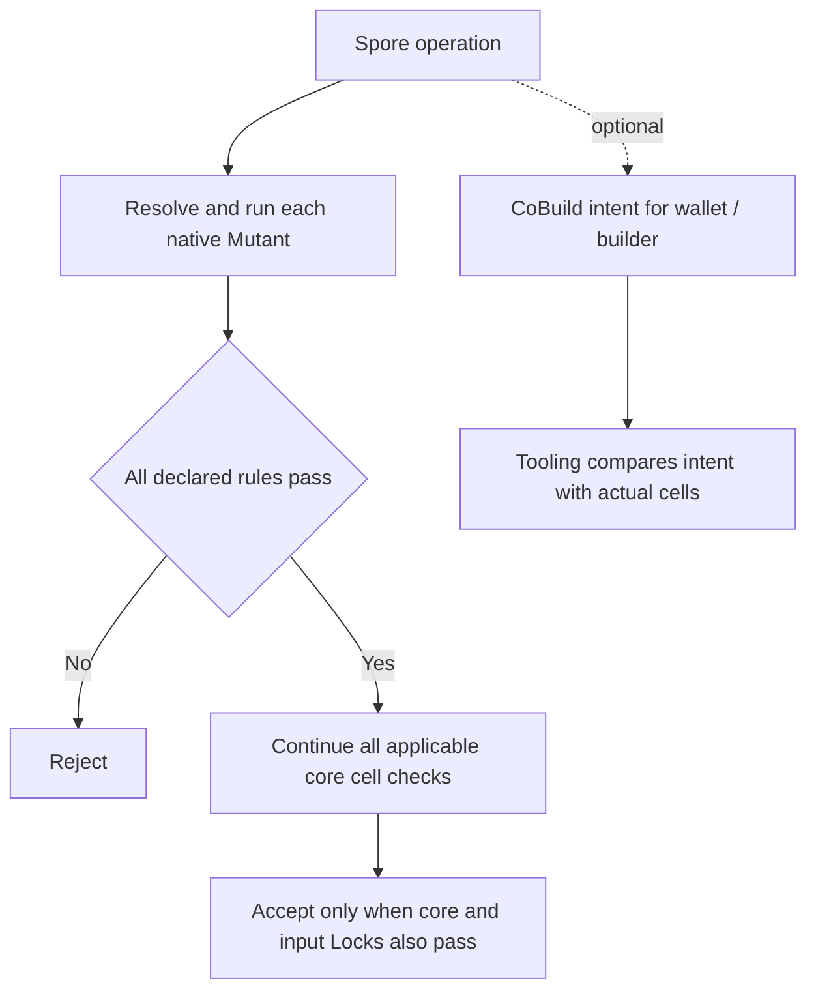

# Spore v3 integration candidate

This branch combines [#75](https://github.com/sporeprotocol/spore-contract/pull/75)
and [#76](https://github.com/sporeprotocol/spore-contract/pull/76) for the
unreleased **Spore v3 / `0.3.0-alpha.1`** candidate. It is an integration target,
not a third feature PR or a deployment. The two upstream PRs remain separate
for review against `master`.

The combined behavior is:



Lua is rejected on the new execution path. It is not built, linked or used as a
fallback. CoBuild Actions are optional for the core; Locks and custom rules
still impose their own witness and authorization requirements. Existing assets
keep their original script bindings and dependencies.

## Resolutions included in this branch

- Keep #75's native-only dispatch, exact dependency/VM binding, checked payments
  and returning execution. Remove only the Action imports/calls superseded by
  #76; keep its explicit cell-shape checks.
- Keep #75's Meepo-capable verifier and SDK versions. Use the matching
  `secp256k1 0.30.0` in the real-signature test and import the legacy Molecule
  traits for unchanged cell schemas.
- Change #75's missing/misleading-Action expectations to the intentional #76
  acceptance behavior, while retaining input-Lock rejection. The opt-in
  performance test follows the same optional-intent rule.
- Replace the standalone #76 Lua-acceptance regression with rejection tests for
  native rules on mint, transfer and burn without Actions. Keep #75's rejection
  of historical Lua dependencies and mixed native/Lua lists.
- Share one source package version across current contracts and libraries;
  leave historical Lua source and deployment records unchanged. The native ABI
  is still `spore-mutant-v1`, and its VM is still CKB-VM V2.

The fixed benchmark snapshots in `benchmarks/native-only` and
`benchmarks/legacy-lua` describe their recorded commits. Their old binary hashes
are not deployment hashes for this combined tree. Run the executable benchmark
on this tree to measure its own build.

## Reproduce the combined verification

```sh
git fetch https://github.com/a19q3/spore-contract.git codex/spore-v3-integration
git switch --detach FETCH_HEAD
# The repository pins Rust 1.92.0.
rustup target add riscv64imac-unknown-none-elf
SPORE_BUILD_RUNNER=cargo \
CC_riscv64imac_unknown_none_elf="$PWD/scripts/clang-riscv.sh" \
./scripts/build-contracts.sh --release
CAPSULE_TEST_ENV=release cargo test --locked --manifest-path tests/Cargo.toml
cargo test --locked -p spore-mutant --lib
CAPSULE_TEST_ENV=release cargo test --locked --manifest-path tests/Cargo.toml \
  native_mutant_performance_report -- --ignored --nocapture
```

The local adapter requires a RISC-V-capable Clang; Cross is the default runner
when `SPORE_BUILD_RUNNER` is not set. Repeat the build/test with no release flags
for debug, and with `--release --features release_export` for mainnet. Changing
configuration must regenerate dependency hash pins; the local matrix also
switches back to debug to check that path.

A release still needs reviewed binaries, new deployment/code-hash records and
explicit SDK/client selection. Neither PR nor this branch creates a release
tag, deploys contracts, upgrades existing cells or changes their signed rules.

## Local verification result

Validated on 2026-11-02 with Rust 1.92.0, direct Cargo and Clang 22.1.8:

| Contract configuration | VM tests |
| --- | --- |
| Debug | 76 passed, 0 failed, 2 ignored |
| Testnet release | 76 passed, 0 failed, 2 ignored |
| Mainnet release | 76 passed, 0 failed, 2 ignored |
| Return to debug | 76 passed, 0 failed, 2 ignored |

The two ignored cases are the historical deployment-transaction generator and
an explicitly run release benchmark. Both release benchmark runs passed, each
verifying every measured transaction five times with identical cycles. The
native ABI unit test also passed. The default core dependency graph contains
no CoBuild parser, and staged artifacts contain only the native build set.

These are local contract/VM results. Docker/Cross and the external SDK/devnet
workflow were not run locally. That workflow checks out separate SDK/devenv
repositories; it does not establish v3 client support or publish the required
new client configuration. SDK/devenv integration still needs validation before
this candidate can be treated as a release.
